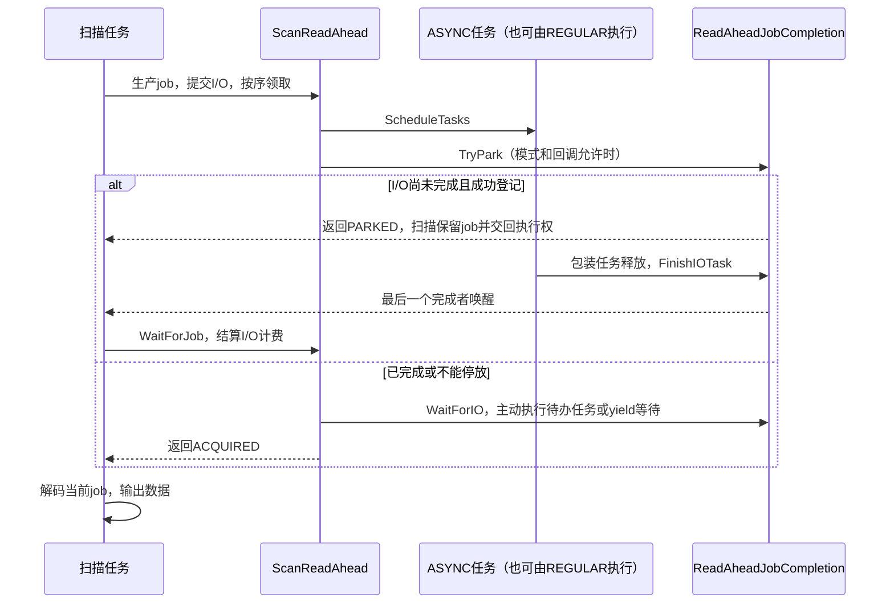
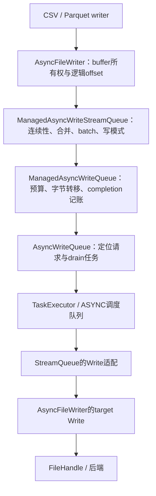

# DuckDB 异步 I/O 总体设计

> 适用源码：`v2.0-cyanoptera` @ `6fdf17af20e`；核对日期：2026-10-23。核对方式：静态源码审查，未执行本文示例或性能测试。

## 一、设计范围与总体架构

当前分支通过调度后台任务，将部分文件打开、数据读取和文件写入与查询计算重叠。读取侧的核心是 ScanReadAhead，写入侧的核心是 AsyncFileWriter 及分层队列；两侧共享 TaskScheduler、TaskExecutor 和内存预算机制，但不使用同一个请求队列或完成协议。

这里的“异步”首先指任务组织与调用方进度协议。它不保证执行 I/O 的线程不阻塞，也不保证所有磁盘或网络访问都被提前提交。比如 [LocalFileSystem](../src/common/local_file_system.cpp) 的 Unix 定位读写实际调用 `pread/pwrite`，并循环处理请求；将这些调用放在 ASYNC 任务中，不会把底层接口变成内核非阻塞 I/O。本文不把当前实现描述成 io_uring 提交/完成队列。

```text
查询计算 / reader / COPY writer
    ├─ 读取：领取扫描工作 → 注册范围 → 提交 I/O → 完成后解码
    └─ 写入：取得 buffer 所有权 → 分配逻辑 offset → 排队 → 写入 target
                 ↓
        TaskScheduler 的 REGULAR / ASYNC 队列
                 ↓
       FileHandle / BufferManager / 外部文件缓存
                 ↓
          本地文件系统或扩展提供的后端
```

这张图表示层次，不表示每次访问都经过所有层。原生表使用存储 BufferManager；Parquet 的预读通过 CachingFileHandle；写入则通过写 target 调用 FileHandle。

与已有文档的分工：

- [异步扫描设计](ASYNC_TABLE_SCAN_DESIGN.md)：TableFunction 实现者面对的结果类型、执行模式和回调契约。
- [异步协议内部实现](ASYNC_TABLE_SCAN_PROTOCOL_INTERNALS.md)：PipelineTask 的停放、恢复、错误发布与框架对象寿命。
- [Pipeline 执行](PIPELINE_EXECUTION_DESIGN.md)和[并行扫描](PARALLEL_SCAN_DESIGN.md)：查询事件依赖、执行并行度及扫描工作领取。
- 本文串起 I/O 的实际生产者、范围读取、缓存、异步写入、预算与收尾，不重复全部扫描协议。

### 核心源码地图

| 层次 | 源码与主要入口 |
|---|---|
| 调度与辅助执行 | [task_scheduler.cpp](../src/parallel/task_scheduler.cpp)：ExecuteForever、SignalForTaskType；[task_executor.cpp](../src/parallel/task_executor.cpp)：ScheduleTask、DrainTasks、CancelAndDrain |
| 读取预取框架 | [scan_read_ahead.hpp](../src/include/duckdb/parallel/scan_read_ahead.hpp)、[scan_read_ahead.cpp](../src/parallel/scan_read_ahead.cpp)：Create、AcquireJob、PushJob、WaitForJob |
| 多文件衔接 | [multi_file_function.hpp](../src/include/duckdb/common/multi_file/multi_file_function.hpp)：ScheduleFileOpens、ProduceJob、AcquireNextReadAhead、AcquireNextPerThread |
| 原生表读取 | [table_scan.cpp](../src/function/table/table_scan.cpp)、[scan_state.cpp](../src/storage/table/scan_state.cpp)、[standard_buffer_manager.cpp](../src/storage/standard_buffer_manager.cpp) |
| Parquet 读取 | [parquet_reader.cpp](../extension/parquet/parquet_reader.cpp)：RegisterRowGroupReads、ScheduleRowGroupReads、ProcessFilters；[parquet_multi_file_info.cpp](../extension/parquet/parquet_multi_file_info.cpp)：ScheduleIO |
| CSV 读取 | [read_single_csv_file.cpp](../src/execution/operator/csv_scanner/table_function/read_single_csv_file.cpp)：ReadSingleCSVFileScheduleIO；[global_csv_state.cpp](../src/execution/operator/csv_scanner/table_function/global_csv_state.cpp)：CSVCollectClaimIOTasks |
| 外部缓存与 transport | [caching_file_system.cpp](../src/storage/external_file_cache/caching_file_system.cpp)：CachingFileHandle::Read、FetchBlockTask；[thrift_tools.hpp](../extension/parquet/include/thrift_tools.hpp)：ReadHead::Fetch、ThriftFileTransport::read |
| 通用任务队列 | [async_task_queue.hpp](../src/include/duckdb/common/serializer/async_task_queue.hpp)、[async_task_queue.cpp](../src/common/serializer/async_task_queue.cpp)：AsyncTaskQueue、ManagedAsyncTaskQueue |
| 文件写入与队列 | [async_file_writer.cpp](../src/common/serializer/async_file_writer.cpp)、[async_write_queue.hpp](../src/include/duckdb/common/serializer/async_write_queue.hpp)、[async_write_queue.cpp](../src/common/serializer/async_write_queue.cpp) |
| 共享内存策略 | [async_memory_governor.hpp](../src/include/duckdb/common/serializer/async_memory_governor.hpp)、[async_memory_governor.cpp](../src/common/serializer/async_memory_governor.cpp)：ManagedAsyncMemoryGovernor |

## 二、任务调度、配置与同步路径

### 2.1 两个队列不构成完全隔离的线程分工

`TaskScheduler::ExecuteForever` 的 REGULAR worker 依次尝试各队列；ASYNC worker 只处理自己的队列。提交 ASYNC 任务时，`SignalForTaskType` 唤醒两个池；提交 REGULAR 任务只唤醒 REGULAR 池。因此读写 I/O 可以由空闲 REGULAR worker 执行，而不是只能由专门 I/O 线程执行。

`TaskExecutor` 持有自己的 ProducerToken，用于从调度器取回属于自己的任务。`DrainTasks` 会在调用线程执行排队任务，或在其他线程正在执行时等待计数完成；`WorkOnTasks` 在 drain 后重新抛出所记录的错误。这让嵌套任务和同步等待不必仅依赖后台线程取得进展。

两种任务包装要区分：

- `TaskExecutorTask` 管理辅助任务的取消检查、异常和完成计数；PROCESS_PARTIAL 可保留计数并重新入队，但该包装不支持 TASK_BLOCKED 的停放/恢复。
- [AsyncResult](../src/parallel/async_result.cpp) 的 `AsyncExecutionTask` 属于查询 Executor，任务批次完成或出错后通知扫描恢复。它与 read-ahead 自己的 completion 不是同一条链路。

计算 PipelineTask 可以停放；执行文件调用的辅助任务一般直接执行到完成，或按其 step 协议交回调度权。不能把二者画成相同状态机。

### 2.2 配置的实际含义

设置声明见 [settings.hpp](../src/include/duckdb/main/settings.hpp)，自定义设置逻辑见 [custom_settings.cpp](../src/main/settings/custom_settings.cpp)，系统默认计算见 [config.cpp](../src/main/config.cpp) 的 GetSystemMaxAsyncThreads。

| 设置 | 当前行为 | 不能由它推断的结论 |
|---|---|---|
| `async_threads` | 全局异步池配置；非负值有效，0可用，NULL/负数报错。未显式指定及 RESET 时按 `min(4 × GetSystemMaxThreads(fs), 256)` 计算；无线程构建为0 | 不是查询扫描并行度；自动值不直接取当前会话的 `threads` 数值 |
| `read_ahead_depth` | 默认-1；-1为按内存预算控制，0禁用公共预读驱动，正数限制尚未领取的job数量；NULL及小于-1报错 | 不是每job的I/O请求数，不是字节数，也不限制已领取job的解码并行度 |
| `storage_block_prefetch` | 默认 REMOTE_ONLY；SingleFileBlockManager::Prefetch 决定原生表是否走预取，NEVER关闭，ALWAYS_PREFETCH/DEBUG_FORCE_ALWAYS对非内存库启用 | 不统一控制Parquet/CSV预读，也不意味着本地原生表默认启用read-ahead |

`ScanReadAhead::Create` 在当前异步池线程数为0，或 depth为0时返回空指针。正depth模式没有安装 ManagedAsyncMemoryGovernor；自动模式使用最大深度值，再靠预算限制backlog。

`AsyncThreadsSetting::SetGlobal/ResetGlobal` 还会在 HTTP client pool 容量处于自动配置时调整其容量，见 ResizeAutomaticHTTPClientPool。池配置与正在运行的请求、连接复用和后端并发能力仍是不同概念；本文不把调整线程数描述成重建所有已存在reader/writer对象。队列是否创建executor等决策有各自的构造时点。

### 2.3 关闭read-ahead不等于消除所有ASYNC任务

multi-file没有公共read-ahead时，`AcquireNextPerThread` 仍然领取job并调用reader的 ScheduleIO，再由 TableFunctionInput::HandleBlocked 决定交回任务或同步执行。原生表不走read-ahead时，也可以对当前vector收集I/O任务。

HandleBlocked 的完整结果协议见[异步扫描设计](ASYNC_TABLE_SCAN_DESIGN.md)。这里应区分：提前生产后续job、当前job按需调度、等待时主动执行任务，以及真正同步调用文件接口。这些机制可在同一查询中组合。

无异步线程时，写队列不创建后台executor，Submit等入口改为同步执行；缓存的内部TaskExecutor仍可由等待方drain。不能从 `async_threads=0` 推断任意内部路径都不会构造任务。

## 三、读取公共框架：生产、完成与解码

### 3.1 job与任务的关系

`ScanReadAheadJob` 保存batch_index、io_completion和io_bytes；具体reader状态通过 ScanReadAheadJobWrapper 包装。一个job可产生多个AsyncTask，也可以不产生任务。batch_index必须按工作领取顺序从0连续分配。

`TryProduceJob` 先预留slot和最低I/O计费，再由回调领取工作并注册I/O。`PushJob` 为任务建立 ReadAheadIOTask 包装，先装好整批completion计数，再调度；并发producer产生的job先进入 pending_jobs，只有连续的batch前缀才进入 ready_queue。

这个顺序是job的准入/领取顺序，不保证I/O完成顺序或并行解码的最终输出顺序。若生产结束且没有active producer，仍有缺号job留在 pending_jobs，AcquireJob显式抛异常，不能把它们当成正常EOF。

### 3.2 completion与扫描停放

以下是成功路径的简化时序；错误和销毁分支见第八节。



TryPark在同一把锁下检查pending计数并登记等待者；最后一个完成者也取此锁后唤醒，以处理“登记时恰好完成”的竞态。通过 TableFunctionInput 停放还要求 TASK_EXECUTOR模式及可用interrupt_state。

ReadAheadIOTask的析构负责 FinishIOTask；`WaitForIO` 观察该计数，并主动执行这个executor的任务，不要求取出的任务必定属于当前job。`WaitForJob` 先SettleIO，再从pending_io_bytes减去job计费并检查错误。恢复后由调用方继续使用保留的job，而不是重新领取一次工作。

### 3.3 深度、计费与状态复用

ClaimJob取走job时就释放active_jobs的slot；I/O字节计费则保留到WaitForJob。已领取但尚未恢复的job因此仍能施加预算压力。超预算时ReservationDepth退到1，保留推进机会；不是对所有活跃job施加一个全局数量硬上限。

producer回调返回空表示生产结束；AcquireJob还要等待active producer并再次检查ready队列才决定EXHAUSTED。暂无ready job时，它先短暂yield，再按progress epoch进入带10ms超时和中断检查的条件变量等待。这是调用线程等待的一种情况，不是每次都以TASK_BLOCKED停放。

ScanStatePool回收已完成job的扫描状态，使Parquet预读选择等学习状态能随逻辑scan state延续。job包装的析构先SettleIO，再销毁具体状态，避免正常销毁顺序中任务仍在使用reader状态。

## 四、读取生产者的具体路径

### 4.1 原生表：assignment预取与vector解码

`CreateTableScanReadAhead` 先检查存储BlockManager::Prefetch，再调用公共Create。原生表job包含TableScanState与扫描行数；ProduceJob在锁内领取NextParallelScan工作并分配连续序号，锁外初始化列扫描并调用 `PrepareScanIO(..., true)`。

[CollectionScanState::PrepareScanIO / RegisterAssignmentIO](../src/storage/table/scan_state.cpp) 先PrepareScan，跳过前面被统计或采样排除的vector，然后登记该assignment的预取范围；PrefetchRowCount还根据过滤列的zonemap扫描边界收缩范围。prepared_vector标记IO_REGISTERED，恢复时不会重复注册；后续vector通过 ProcessPreparedScan 解码。

不走read-ahead时，PrepareScanIO可按当前vector收集任务，通过HandleBlocked完成后解码；持久化扫描结束还要处理事务本地存储，不能把预取EOF当成整个表扫描的EOF。

[StandardBufferManager::RegisterPrefetch](../src/storage/standard_buffer_manager.cpp) 排除已加载块，按block id排序去重，将相邻块组成run；CreatePrefetchTasks为run生成带I/O字节估计的CallbackAsyncTask，实际执行BatchRead。run目标大小为32MiB，但结尾单块可附加到达到上限的run，因此这不是严格的32MiB硬上限。同步ExecutePrefetch还可跳过单块run；不能将该条件直接套用到CreatePrefetchTasks。

异步预取只负责把存储块准备好，MVCC、过滤与codec解码仍在扫描链处理。不同压缩/更新路径的解码粒度见[Filter执行](FILTER_EXECUTION_DESIGN.md)，不能从输出选择率推出相同比例的I/O或解码节省。

### 4.2 multi-file：提前打开文件与领取扫描job

multi-file通过接口 SupportsReadAhead 决定是否调用公共Create。支持时，ScheduleFileOpens将后续文件标记OPENING并提交打开任务；打开任务执行reader初始化、PrepareReader及PrepareReadAhead。open窗口由异步线程数和depth模式共同计算，前方文件的推进保证还可能越过普通窗口检查。

ProduceJob领取具体文件的工作，调用reader的ScheduleIO，提取返回的携任务结果；公共框架取得job后交给DecodeCurrentJob。无read-ahead时使用AcquireNextPerThread，仍复用reader的ScheduleIO和解码逻辑。扫描状态在NONE、SCHEDULE、WAIT_IO、DECODE等状态之间衔接，持有的job可以跨多次调用恢复。

文件提前打开有单独的pending_opens计数和错误/取消通知；它不是数据读取job的io_bytes计费。文件级过滤、reader初始化和metadata读取也可能早于行级解码。不能承诺任意过滤命中都避免了打开文件或所有物理读取。

### 4.3 Parquet：按范围预读与过滤列分阶段读取

`PrepareReadAhead` 提前初始化scan handle；同一reader的row-group scan state共享以parallel-access方式打开的handle。每个scan state持有独立的Thrift transport和读头状态。

RegisterRowGroupReads先准备列reader、做统计排除，再根据配置和代价启发式注册读头。主要策略如下：

| 策略 | 初始调度内容 | 后续行为 |
|---|---|---|
| WHOLE_GROUP | row-group跨度对应的读头 | 已预读范围供后续列解码使用，可能包含投影外的间隙 |
| COLUMN_WISE_EAGER | 所有所需列的读头 | 按列范围读取，可合并相邻范围 |
| PREFETCH_FILTERS | 读头列表末尾的filter读头 | 先EvaluateFilters，有匹配且存在payload读头时，再调度剩余列 |
| NONE | 不产生该轮预读任务 | 解码需要数据时走transport的按需读取路径 |

AUTO选择考虑扫描压缩字节占row-group跨度比例、过滤列成本和历史row-group匹配比例；不等于任何带filter的查询都先只读filter列。reader状态复用会影响后续选择。

CollectIOTasks只为尚未fetch的ReadHead构造CallbackAsyncTask，捕获读头和shared CachingFileHandle，执行ReadHead::Fetch。PREFETCH_FILTERS在ProcessFilters中取得精确选择后，ScheduleRemainingColumns可再次返回携任务AsyncResult，并以resuming_payload保留当前块，恢复后继续解码而不重做已完成的过滤。

这不是逐行随机I/O：payload任务读取注册的范围，并不只取命中行对应的字节。已经发出的预取也不会因为后来动态filter排除整个row-group而自动撤销；过滤收益取决于生效时点。

[ThriftFileTransport::read](../extension/parquet/include/thrift_tools.hpp) 在读头尚未fetch时仍可就地Fetch；不在已注册范围内时还可能做fallback预取或直接FileHandle::Read。metadata、按需payload或其他未覆盖范围仍可能在调用线程发起读取。

### 4.4 CSV：按可寻址buffer预读

ReadSingleCSVFileSupportsReadAhead依赖buffer manager及HasKnownBufferRanges。[CSVFileHandle](../src/execution/operator/csv_scanner/buffer_manager/csv_file_handle.cpp) 的当前条件是未压缩、可seek、非pipe且编码为UTF-8；不能把gzip或流式输入直接当成同样的并行范围预读。

CSVCollectClaimIOTasks检查领取工作起始buffer的驻留状态，只有NEEDS_LOAD才提交加载任务；边界触及buffer末尾时，还可能预读下一个buffer以处理跨界值和首行识别。任务捕获shared CSVBufferManager，执行GetBuffer，字节估计来自已知buffer大小或配置大小。

随后在扫描侧Materialize并进行CSV解析、转换和错误记录。它不是将整个CSV解析器迁入ASYNC池，也不保证跨越任意数量buffer的长记录都已预读。

## 五、外部文件缓存与文件系统边界

### 5.1 CachingFileHandle::Read在返回前取得所需数据

外部缓存的Read接口本身返回FileBufferHandleGroup，而不是future。可缓存路径会根据文件大小、cache block大小及request sizing对齐/扩展请求，AcquireBlocks后为块提交FetchBlockTask，调用局部TaskExecutor::WorkOnTasks等待完成，再组合pin。

FetchBlockTask在block锁下处理LOADED、EMPTY、LOADING、IO_ERROR：已加载且pin有效则复用；缺失时一个执行者转LOADING并读取，其他执行者等待；读取失败通知等待者，后续任务可从IO_ERROR退回EMPTY再次尝试。缓存中存在记录不保证buffer尚未被驱逐，也不意味着当前文件验证仍然有效。

禁用缓存等路径转ReadUncached；满足大小、路径、seek及可并行条件时仍可拆成ReadRangeTask并等待。因此“外部缓存关闭”与“范围读取不并行”是不同选择。

### 5.2 两层任务与buffer寿命

Parquet读头任务调用CachingFileHandle::Read，后者内部又可能调度块任务。这是嵌套辅助执行；内层等待方可以主动取任务执行，不要求为每层各保留一个空闲后台worker。

ReadHead保留FileBufferHandleGroup以维持数据pin；单handle可直接使用其地址，多handle则Materialize到连续buffer并复制。预算里的GetIOSize并不因此精确等于实时物理读取量或最终常驻内存：缓存命中、block对齐、重复范围和拼接buffer都会改变关系。

CachingFileHandle::GetFileHandle在锁下延迟打开，并对底层句柄增加FILE_FLAGS_PARALLEL_ACCESS，为同一handle上的并发定位读取申请正确契约。reader自己的逻辑position和底层handle的共享游标不能混为一谈。

本仓库能证明FileSystem/FileHandle接口、parallel-access标志、HTTPTransportManager以及缓存调用方的行为；外置HTTPFS/S3等后端的全部连接、重试、上传和发布实现不在本文覆盖范围。不能仅凭该标志断言任意第三方FileSystem都线程安全。

## 六、异步写入：从逻辑流到物理请求

### 6.1 各层队列的责任

以下为AsyncFileWriter当前的实际写入路径，不应插入一个它没有调用的通用任务队列：



底层队列通过target引用回调实际writer，所以任务完成前writer、队列与handle必须继续存在。

| 组件 | 负责的内容 |
|---|---|
| AsyncTaskQueue / ManagedAsyncTaskQueue | 通用AsyncTask请求、并发上限、完成回调、待办字节与预算；不提供文件offset或流顺序语义，不是上图的writer必经层 |
| AsyncWriteQueue | 独立定位写请求、owned payload与completion；管理queued/in-flight字节及drain并发，本身不负责逻辑流合并 |
| ManagedAsyncWriteQueue | 在定位写队列外增加预算和submitted记账，跟踪尚未移交的external_pending_bytes |
| ManagedAsyncWriteStreamQueue | 按连续offset登记逻辑流，选择物理请求、合并buffer、处理batch与FileWriteMode |
| AsyncFileWriter | 打开handle、暂存调用方字节、维护逻辑总长度，提供WaitAll/Close/AbortWrite/Sync等生命周期入口 |

ManagedAsyncTaskQueue::Register与ApplyBackpressure/WaitAll、Close遵循自己的契约；不能把它们的完成通知直接当成扫描job的唤醒，也不能假定“managed”意味着每次Register都阻塞到预算以内。

### 6.2 buffer所有权与逻辑offset

AsyncFileWriter需要ClientContext，构造时打开FileHandle并创建stream queue；此处文件打开本身仍在构造调用中完成。初始化队列失败会对取得的handle调用AbortWrite。

`WriteData(const_data_ptr_t, size)` 对调用方的临时内存做复制，包括大输入，不能保存裸指针到后台使用。小输入进入4KiB copied buffer，封口后按原offset提交；`WriteData(unique_ptr<AsyncWriteBuffer>)` 转交owned buffer，异步模式可避免这一层额外复制，但后续合并或后端仍可能复制。

GetTotalWritten/GetFileSize返回逻辑长度，包含暂存、排队和尚未物理写出的字节；GetPhysicalFileSize先WaitAll再查询handle。异步登记成功不等于文件已产生同样大小。

StreamQueue校验每次登记offset必须等于next_registration_offset，并检查加法溢出。底层AsyncWriteQueue接受独立范围，不会替调用方证明范围互不重叠；这与上层“连续逻辑流”的约束不同。

### 6.3 三种文件写模式

模式定义见 [file_write_mode.hpp](../src/include/duckdb/common/enums/file_write_mode.hpp)，target能力来自FileHandle::GetWriteMode。

| 模式 | 上层调度/调用契约 |
|---|---|
| SEQUENTIAL | 使用handle共享流位置；stream queue只允许一个submitted request活跃，最终调用不带offset的Write |
| CONCURRENT_SEQUENTIAL | 请求携连续逻辑offset；target按序接纳后允许后端工作重叠。stream queue在提交前物化payload，并允许多个请求活跃；实际按序接纳责任仍在target |
| POSITIONAL | 独立范围可按任意顺序完成；stream queue可并发提交，最终使用带offset的Write |

FileSystem默认模式是SEQUENTIAL；LocalFileSystem对FIFO/字符设备返回SEQUENTIAL，其余返回POSITIONAL。不能只因存在带offset的Write重载就推断某个后端支持独立并发定位写。压缩包装、管道及远端provider应按实际声明的模式阅读。

顺序写的AsyncFileWriter::Write会循环处理短写，对零/负返回值或超过请求长度报错。定位写则调用handle对应接口，不使用同一套返回字节数循环。

### 6.4 合并、batch与背压时机

编译期策略在AsyncWriteConfig：小输入暂存4KiB，本地合并阈值4KiB，远端合并阈值8MiB，底层task字节预算4MiB，stream提交窗口使用至少16MiB的drain预算。这些是调度/合并策略，不是单请求长度的普遍硬上限；大owned payload可以作为完整请求处理。

本地首个任务可立即提交，远端首个任务通常积累到合并阈值；之后由completion补充队列。小尾部可留到强制drain再提交。连续小buffer合并时可能分配连续内存，不能将owned接口概括成端到端零拷贝。

BeginBatch增加batch_depth，禁止stream新请求的选择，已有请求仍可继续执行。BatchGuard::Finish显式LeaveBatch并在合适时机ApplyBackpressure；析构只处理异常退出并有断言要求，不能把它当成无条件成功flush的RAII提交器。

真实调用方 [ParquetWriter::FlushRowGroup](../extension/parquet/parquet_writer.cpp) 在batch内、writer锁下登记列数据，离开锁后调用Finish；最终写完footer再Close。[CSV COPY](../src/function/table/copy_csv.cpp)通过CSVWriter把数据交给AsyncFileWriter，最终显式Close。这里的batch是写请求调度批次，与PhysicalBatchInsert不同。

### 6.5 等待、关闭、持久化与失败

| AsyncFileWriter入口 | 源码中的作用 |
|---|---|
| Flush / WaitAll | 封口暂存buffer，强制排空已登记写入并传播任务错误；WaitAll临时打开batch进行drain，再恢复batch状态 |
| ApplyBackpressure | 非batch状态下按预算推进队列；可能在调用线程执行写任务，不要求等待所有写入完成 |
| Close | 排空并关闭队列；对本地未压缩普通文件校验最终大小，再调用handle->Close；成功后记PUBLISHED并释放handle |
| AbortWrite | 停止登记、丢弃未提交buffer，等待已调度工作安全收尾，再调用底层AbortWrite；不等于任意后端上的事务回滚 |
| Sync | 先WaitAll，再调用handle->Sync；不是Flush的别名 |
| Truncate | 先WaitAll，再truncate、更新逻辑长度与下次登记offset，必要时调整seek位置 |

Close中handle关闭异常会保存first_error、记UNKNOWN并结束writer生命周期；不能把“关闭失败”当作文件一定未发布。PUBLISHED也是writer对成功Close的内部状态，不是对操作系统掉电持久性或远端事务提交的独立证明。

AsyncFileWriter析构在尚未finished时尝试AbortWrite，并吞掉清理异常；正常成功必须走显式Close。高层保存的first_error与队列记录的异步错误分别在相应入口重新抛出，清理失败不应被文档描述成替代原始写失败。

## 七、共享内存策略与背压边界

ManagedAsyncMemoryGovernor供自动read-ahead、managed task queue和managed write queue复用。设 `R = max(scheduler.NumberOfThreads(), 1)`、`M = BufferManager::GetMaxMemory()`，构造时计算：

```text
max_pending_bytes = min(64 MiB × R, M / 8)
min_pending_bytes = min(max_pending_bytes, 8 MiB × R, M / 16)
```

这里R来自调度器所报告的REGULAR池线程数，不应擅自替换成SQL `threads`配置或ASYNC池大小。仅异步线程数大于0且max_pending_bytes大于0时注册TemporaryMemoryState。UpdateReservation按粗粒度增长请求，Release才清零；它调用当前TMM预约接口，不吞掉其异常，也不改变其他消费者的required reservation契约。

BackpressureBudget将实际reservation与max_pending_bytes取较小值；低于8MiB时返回0，使managed消费者尽量不保留异步backlog。未激活governor时返回最大值，此时同步路径或消费者自身策略负责推进。它不是进程RSS、整个缓存或全部reader内存的硬上限。

### 7.1 读取计费

自动read-ahead在slot预留时先计最低job费用16MiB（MINIMUM_JOB_IO_CHARGE），PushJob再补足任务大小，最终 `io_bytes = max(各AsyncTask::GetIOSize之和, 16MiB)`。即使job没有实际I/O任务，也保留最低计费。WaitForJob才释放这笔费用；生产的预留在失败或无job时由ProducerReservation回退。

预算限制的是可积累的job I/O估计，不包括所有metadata、open任务、解码结果、缓存复制或后台正在分配的临时空间。一次大job先被计入后才更新预算，也可能超过预算值。正数depth模式没有这个governor，但仍有限制队列job数量的slot策略。

### 7.2 写入计费

ManagedAsyncWriteQueue跟踪external pending、pending与submitted字节；stream在使buffer对completion补队列可见前先登记external字节，TryAdoptAccountedWrite接收后将它移入pending，避免层间移交丢失记账。

ApplyBackpressure在总待办字节超过预算时强制调度并WorkOnPendingTask，低预算时近似同步推进。batch内可暂缓预约更新与背压，因此单个大batch也能暂时积累较多内存；copied staging、合并副本和调用方尚未交出的buffer不等于每层计数之和。不能把多层submitted_bytes相加当成不重复的真实内存占用。

## 八、错误、取消与对象寿命

三条完成链路有各自的错误传播顺序：

| 路径 | 核对到的行为 | 使用时的边界 |
|---|---|---|
| 携任务AsyncResult | AsyncExecutionTask在错误分支先SignalCompletion，再抛给外层ExecutorTask处理 | 被唤醒不证明全部任务已结束或外层查询错误已发布；详见已有协议文档 |
| ScanReadAhead | ReadAheadIOTask捕获std异常后PushError并通知progress，包装任务释放时结算completion；WaitForJob再次检查错误 | completion计数、TaskExecutor完成计数和对象最后一次引用释放不是同一个事件；未知异常也不能套用这一条std异常的精确顺序 |
| managed写队列 | 请求释放payload并调用completion；任务包装保存错误。等待/关闭负责drain、验证计数并重新抛错 | completion还参与上层记账和补队列，不能把一次回调无条件当作整个文件成功 |

TaskExecutor::CancelAndDrain先置cancelled，未开始的任务转Cancel，已运行任务需要结束后才能完成drain；它不强行中止一个正在执行的pread、网络请求或用户callback。扫描/写入owner也必须先停止新的并发生产者，不能一边无限Schedule一边期待CancelAndDrain替自己完成所有生命周期管理。

ReadAheadJobWrapper先SettleIO保护具体job状态；ScanReadAhead析构会CancelAndDrain。multi-file异步open闭包还引用context、bind data及global state，其owner要在释放这些对象前完成相应收尾。析构顺序和引用计数是契约的一部分，仅看HasError或completed_tasks不足以证明任意外部引用都已释放。

写队列的Close在成功路径检查drained；失败路径先尽力完成已调度请求，再丢弃未提交请求并清理记账。AbortWrites不会撤销已完成的物理写入。底层FileHandle::AbortWrite、Close及远端上传发布的语义仍由provider负责，不能在通用队列文档中承诺任意失败都删除目标文件。

## 九、静态核对与后续验证入口

本次逐项核对了上述公共声明、主要实现及原生表、multi-file、Parquet、CSV/COPY的调用方；覆盖关闭预读、零异步线程、缓存命中/缺失、低预算、分阶段payload读取、短写、错误与提前销毁分支。该覆盖是源码阅读，不是运行验收。

仓库已有以下测试入口，可用于后续独立运行验证；本次只检索了文件和相关测试声明，未运行，也未审阅全部断言：

| 场景 | 现有入口 |
|---|---|
| 通用队列、并发上限、同步退化、错误传播 | [test_managed_async_task_queue.cpp](../test/common/test_managed_async_task_queue.cpp) |
| buffer所有权、三种写模式、batch、短写、关闭/失败 | [test_async_file_writer.cpp](../test/common/test_async_file_writer.cpp) |
| 原生表预读与并发 | [async_native_scan_read_ahead.test](../test/sql/storage/prefetch/async_native_scan_read_ahead.test)、[async_native_scan_read_ahead_concurrent.test](../test/sql/storage/prefetch/async_native_scan_read_ahead_concurrent.test) |
| Parquet预算、depth、动态剪枝与故障收尾 | [read_ahead目录](../test/sql/copy/parquet/read_ahead) |
| CSV单/多文件及不适用输入 | [CSV read_ahead目录](../test/sql/copy/csv/read_ahead) |
| 放弃流式结果、读取失败 | [test_read_ahead_abandon.cpp](../test/api/test_read_ahead_abandon.cpp)、[test_read_ahead_failure.cpp](../test/api/test_read_ahead_failure.cpp) |
| 运行中调整线程数与预读 | [concurrent_set_async_threads_read_ahead.test](../test/sql/parallelism/interquery/concurrent_set_async_threads_read_ahead.test) |

本文没有证明所有文件系统provider的并发/取消行为、未知异常的全部时序、运行中配置切换的所有组合，或网络/磁盘故障下的持久性。吞吐量、尾延迟和内存收益还取决于缓存、过滤选择率、解码成本、请求合并和后端并发限制；没有给出固定性能提升比例。
