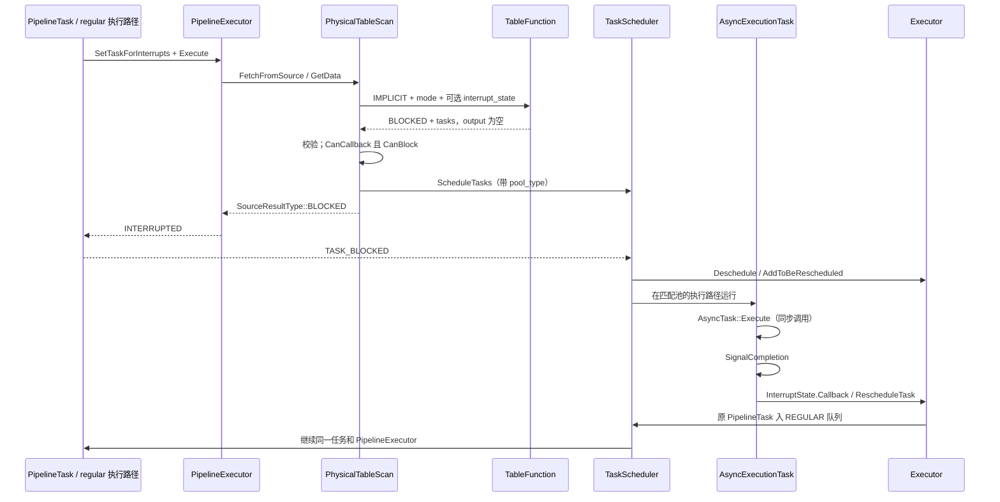

# DuckDB 异步 TableFunction 协议内部实现（Framework 视角）

> 适用源码：`v2.0-cyanoptera` @ `c1cd2470a455`；核对日期：2026-10-23。核对方式：静态源码审查，未执行本文示例或性能测试。

## 概述与源码地图

[异步扫描设计](ASYNC_TABLE_SCAN_DESIGN.md) 从函数实现者说明结果协议；本文追踪框架接收结果、调度、停放、唤醒、异常和销毁的链路。代码骨架/时序图是按源码整理的简化表示，未编译运行，不是源码逐字摘录。

| 层次 | 声明/实现与符号 |
|---|---|
| 函数输入 | [table_function.hpp](../src/include/duckdb/function/table_function.hpp)：TableFunctionInput；[table_function.cpp](../src/function/table_function.cpp)：HandleBlocked |
| 策略 | [physical_table_scan_enum.hpp](../src/include/duckdb/execution/physical_table_scan_enum.hpp)：PhysicalTableScanExecutionStrategy |
| 普通 Source 适配 | [physical_table_scan.cpp](../src/execution/operator/scan/physical_table_scan.cpp)：GetDataInternal、ValidateAsyncStrategyResult |
| 异步结果 | [async_result.hpp](../src/include/duckdb/parallel/async_result.hpp)、[async_result.cpp](../src/parallel/async_result.cpp)：AsyncResult、AsyncExecutionTask、AsyncBatchCompletion |
| 物理输入 | [physical_operator_states.hpp](../src/include/duckdb/execution/physical_operator_states.hpp)：OperatorSourceInput |
| Pipeline 执行 | [pipeline_executor.cpp](../src/parallel/pipeline_executor.cpp)：SetTaskForInterrupts、FetchFromSource、Execute；[pipeline.cpp](../src/parallel/pipeline.cpp)：PipelineTask::ExecuteTask |
| 通知 | [interrupt.hpp](../src/include/duckdb/parallel/interrupt.hpp)、[interrupt.cpp](../src/parallel/interrupt.cpp)：InterruptState、StateWithBlockableTasks |
| 查询任务 | [executor_task.cpp](../src/parallel/executor_task.cpp)：Execute、Deschedule、Reschedule；[executor.cpp](../src/parallel/executor.cpp)：RescheduleTask、CancelTasks |
| 调度 | [task_scheduler.cpp](../src/parallel/task_scheduler.cpp)：ScheduleTask、ExecuteForever；[task_scheduler_queue.cpp](../src/parallel/task_scheduler_queue.cpp)：ProducerToken |
| 读前预取 | [scan_read_ahead.hpp](../src/include/duckdb/parallel/scan_read_ahead.hpp)、[scan_read_ahead.cpp](../src/parallel/scan_read_ahead.cpp)：ReadAheadJobCompletion、ScanReadAhead、ReadAheadIOTask |
| 辅助执行器 | [task_executor.cpp](../src/parallel/task_executor.cpp)：TaskExecutorTask、TaskExecutor::CancelAndDrain |

## 一、一次普通 TableFunction 调用

### 1.1 PipelineTask 的上下文连续性

`PipelineTask::ExecuteTask` 懒创建自己的 PipelineExecutor，每次执行前 `SetTaskForInterrupts(shared_from_this())`，再按 PROCESS_PARTIAL/PROCESS_ALL 选择执行预算。PipelineExecutor 保存本地扫描状态和恢复位置，BLOCKED 后不销毁它；唤醒仍指向同一个任务对象，不是另建“新的调度实例”。实际执行该对象的 worker 可以改变。

`FetchFromSource` 用 global/local Source 状态和 interrupt_state 构造 OperatorSourceInput，调用物理 Source::GetData，接收 SourceResultType 及 batch_index_state。普通数据阻塞使 Execute 返回 INTERRUPTED；空批次推进还有单独的 pending_batch_advance_state，不能把所有 BLOCKED 都画成完全不触碰下游的单一步骤。

### 1.2 PhysicalTableScan 准备输入

`GetDataInternal` 构造一个栈上的 TableFunctionInput。若 OperatorSourceInput.interrupt_state.CanCallback()，把其地址放入 data.interrupt_state；否则该字段为空。普通 function 分支随后：

1. 将 data.async_result 从默认 INVALID 改为 IMPLICIT。
2. 根据全局 Source 状态的 execution_strategy 计算 mode，设置 results_execution_mode。
3. 调用 function.function(context.client, data, chunk)。
4. 读取结果并调用 ValidateAsyncStrategyResult。
5. 处理 BLOCKED 或调用 AsyncResult::GetSourceResultType 转换其他结果。

TableFunctionInput 及其字段引用仅在当前调用栈有效。长期唤醒登记应保存 InterruptState 的副本和有效业务状态，不可保留这个临时 input 或裸指针以备未来解引用。

### 1.3 GetDataInternal 的结果分发

简化状态图：

```text
async_result != BLOCKED:
    IMPLICIT -> 按 chunk.size() 转 HAVE_MORE_OUTPUT / FINISHED
    HAVE_MORE_OUTPUT / FINISHED -> 对应 SourceResultType
    INVALID -> 转换处抛异常

BLOCKED 且没有 tasks:
    直接返回 SourceResultType::BLOCKED（函数已经自行登记唤醒）

BLOCKED 且带 tasks:
    CanCallback 且 g_state.CanBlock(): ScheduleTasks → 返回 BLOCKED
    否则: ExecuteTasksSynchronously → 返回 HAVE_MORE_OUTPUT
```

有任务分支在全局 Source 的 annotated_mutex 下检查 CanBlock 并提交任务；无任务分支不代为登记、不执行这项 CanBlock 检查，也不凭空获得唤醒源。不能继续使用旧文档的“CanBlock false 就直接 FINISHED”结论。

## 二、模式与运行时校验

`AsyncResult::ConvertToAsyncResultExecutionMode` 的映射：

| execution strategy | 传给函数的 mode | 校验 |
|---|---|---|
| DEFAULT、TASK_EXECUTOR | TASK_EXECUTOR | BLOCKED 的 output 必须为空 |
| TASK_EXECUTOR_BUT_FORCE_SYNC_CHECKS | TASK_EXECUTOR | 使用下列同步严格校验，便于暴露旧同步假设 |
| SYNCHRONOUS | SYNCHRONOUS | 禁止 BLOCKED/INVALID，FINISHED 必须空、HAVE_MORE_OUTPUT 必须非空 |

ValidateAsyncStrategyResult 还拒绝函数修改 mode、或调用前结果不是 IMPLICIT。这些是抛 InternalException 的检查。它在函数返回后核对记录的前后值，并非在调用前就完整校验一次、调用后再完整校验一次。

TASK_EXECUTOR 下，显式空 HAVE_MORE_OUTPUT 是“仍有工作”，不等同 EOF，也不直接强制 task 重新入队。FINISHED 可带最后一块数据，PipelineExecutor 在标记耗尽后仍推送非空块。IMPLICIT 则始终按块大小判定，因此空 IMPLICIT 不能用于暂时等待。

枚举头文件 [operator_result_type.hpp](../src/include/duckdb/common/enums/operator_result_type.hpp) 的部分概括注释仍称 HAVE_MORE_OUTPUT 必须非空、BLOCKED 必带任务；本文以当前调用方与实现的具体分支为准。这是静态文档核对发现的注释边界，不在本任务修改源码。

## 三、携任务 BLOCKED 的调度时序



图示为成功路径；任务可以在 PipelineTask 完成 Deschedule 之前运行并通知，所以两条链不是严格先后执行。`Executor::RescheduleTask` 在 executor_lock 下反复查找 to_be_rescheduled_tasks，每轮释放锁；找到时移除停放引用并提交 REGULAR 队列，取消时立即退出。这解决 Callback 早于 Deschedule 的登记竞争，不是无条件回调任意时间都安全的许可证。

PipelineTask 收到 INTERRUPTED 不调用 Event::FinishTask；只有执行完整结束才完成事件并 reset PipelineExecutor。预算耗尽则 TASK_NOT_FINISHED，由调度器立即入回原队列；这与等待外部 Callback 的 TASK_BLOCKED 是不同分支。

## 四、AsyncResult 的所有权与状态变化

### 4.1 构造、赋值与工厂函数

[AsyncResult](../src/parallel/async_result.cpp) 中：

- 默认构造为 INVALID。
- 从 SourceResultType 构造会转到内部 AsyncResultType 构造；构造 BLOCKED 会抛异常，要求提供任务。
- 携 vector<unique_ptr<AsyncTask>> 构造为 BLOCKED，拒绝空 vector；pool_type 默认 REGULAR。
- `FromTasks`：列表空时返回 HAVE_MORE_OUTPUT，否则产生携任务 BLOCKED。
- `FromChunk`：空块 FINISHED，非空 HAVE_MORE_OUTPUT。
- `operator=(AsyncResultType)` 和 `operator=(SourceResultType)` 设置状态并清空 tasks；因此 **赋值 BLOCKED 可表示 taskless park**，并非所有 BLOCKED 必须通过携任务构造器。

没有任务的 BLOCKED 只表达“已停放”，正确的唤醒登记由调用者实现。赋值运算符不自动证明这个登记已经发生。

### 4.2 消费操作

| 方法 | 前置/后置与错误边界 |
|---|---|
| ScheduleTasks | 运行时要求 BLOCKED 且 tasks 非空；逐个移动到 AsyncExecutionTask，成功后 clear tasks 并设 INVALID；不能再次消费该结果 |
| ExecuteTasksSynchronously | 同样要求 BLOCKED 且 tasks 非空；当前线程串行 Execute，成功后 clear tasks 并设 HAVE_MORE_OUTPUT；不发 Callback |
| ExtractAsyncTasks | 先 D_ASSERT 当前不为 INVALID，再设 INVALID，并返回任务 vector 的右值引用；实际接收方移动走任务 |
| GetSourceResultType | IMPLICIT 按大小转换，HAVE_MORE_OUTPUT/FINISHED 直接转换；BLOCKED/INVALID 抛异常 |
| HasTasks / GetResultType | 用 D_ASSERT 检查非 INVALID、有 tasks 时必须 BLOCKED；允许 BLOCKED 没有 tasks |

ScheduleTasks 成功后已经清理并失效，旧文档“向量仍保留 null unique_ptr，占位且状态仍 BLOCKED”已不适用。这里的成功后置条件不代表提交中途异常也满足全部后置条件；函数并未给每次逐个提交失败提供原子回滚承诺。

`ExtractAsyncTasks` 返回右值引用这点也需注意：方法标记 INVALID，向量内容由后续 move 取走，不能仅凭返回语句承诺任何调用者都已完成移动。

## 五、完成、异常与最多一次通知

`AsyncExecutionTask` 继承 ExecutorTask，持有一个 AsyncTask、InterruptState 副本和共享 AsyncBatchCompletion。普通成功路径先执行 AsyncTask::Execute，再原子递减共享计数；最后一个任务完成时发通知。

当前实现还显式捕获所有异常，先以 BATCH_ERRORED 调用 SignalCompletion，再重新抛出，由 ExecutorTask::Execute 捕获、存入 Executor 错误并返回 TASK_ERROR。AsyncBatchCompletion 使用 callback_sent.compare_exchange_strong，**一批任务至多尝试发送一次 Callback**。与旧版本“只有所有任务正常完成后才通知恰好一次”不同：某个任务出错就可以提前通知，其他任务仍可能在执行。

```text
ExecuteTask:
  try AsyncTask.Execute()
  catch ...:
    SignalCompletion(BATCH_ERRORED)
    rethrow
  SignalCompletion(BATCH_FINISHED)

SignalCompletion:
  finished = (--counter == 0)
  if errored or finished:
    if callback_sent 从 false 成功改为 true: Callback()
```

这是转写骨架，不是可编译摘录。计数检查使用 D_ASSERT(counter > 0)，不能把它当作释放配置中的 underflow 检测，也不涉及所谓 double-free 保证。取消导致未执行任务直接销毁、排队提交失败、回调接收方已消失等都不能套用“必定通知一次”。

异常通知还不表示全批 I/O 都已完成，不能在收到通知时无条件销毁其他任务仍引用的数据；必须遵守查询错误/取消和 drain 的生命周期。Callback 发生在异常继续向 ExecutorTask 冒泡之前，不能额外推导“Callback 时错误一定已发布到 Executor”的顺序保证。

## 六、TaskScheduler 分池与调用线程

当前 TaskScheduler 拥有 REGULAR、ASYNC 两组池和队列。`ProducerToken` 给每组队列分别创建底层 producer token；一个 Executor 的外层 token 将其多个队列任务纳入归属统计和清理，并不是单一物理队列。

- `AsyncResult::ScheduleTasks` 使用 Executor::GetToken 和结果自身 pool_type。
- `ExecuteForever(REGULAR)` 检查所有队列；ASYNC worker 只检查 ASYNC 队列。
- `GetTaskFromProducer` 也依次查询所有队列，执行器协作/等待/drain 的调用线程可主动取任务。
- RescheduleTask 未显式传池，恢复的普通 PipelineTask 回到 REGULAR。

因此不能说“全部共享一个 pool”，也不能反过来说 async I/O 必定不会占 compute 线程。AsyncTask::Execute 是同步虚方法；其内部阻塞会占用执行它的真实线程，没有自动协程挂起或抢占时间上限。池的配置与工作量决定实际并发，本文不推导性能提升。

## 七、taskless BLOCKED 与 ScanReadAhead

### 7.1 停放协议

[ReadAheadJobCompletion::TryPark](../src/parallel/scan_read_ahead.cpp) 在 TASK_EXECUTOR 且 input.interrupt_state 非空时，持 parked_scan.lock 检查 pending_io_tasks；如果仍有 I/O，就把 InterruptState 副本登记到 StateWithBlockableTasks，并赋 taskless BLOCKED。

`FinishIOTask` 递减 pending 计数，最后一个在同一锁下 UnblockTasks。检查/登记和完成通知使用同一把锁，避免遗漏唤醒。`CanCallback()` 只表示模式非 NO_INTERRUPTS，不保证 weak_ptr 仍存活；实际 Callback 锁定失败时成为 no-op。

框架此时不调用 AsyncResult::ScheduleTasks：I/O 在生产 job 时已经由 ScanReadAhead 的 **独立 TaskExecutor（ASYNC 池、独立 producer）** 提交。不能把这条路径画成 Executor::GetToken 上的 AsyncExecutionTask 批次。

### 7.2 job 与等待路径

`ScanReadAhead::AcquireJob` 先尝试填充队列再领取 job；短暂没有 job 时可能线程 yield，之后 WaitForProgress；取得 job 后尝试 park，无法 park 或 I/O 已完成则 WaitForJob。因此 TASK_EXECUTOR 不保证 AcquireJob 总是即时返回。

ReadAheadJobCompletion::WaitForIO 在 pending 非零时尝试从辅助 TaskExecutor 取任务在当前线程执行；没有可取任务则 YieldThread 等待其他线程，不是固定条件变量挂起。WaitForJob 结算 I/O、释放字节预算后 ThrowIfError。内置表扫描和多文件扫描的恢复点分别见 [DuckTableScanState::ScanWithReadAhead](../src/function/table/table_scan.cpp) 和 [MultiFileFunction::AcquireNextReadAhead / DecodeCurrentJob](../src/include/duckdb/common/multi_file/multi_file_function.hpp)。

### 7.3 销毁与辅助执行器

ReadAheadIOTask 的析构调用 FinishIOTask，即使未执行工作而被取消也会减少 job 的 pending；执行异常经 ScanReadAhead::PushError 记录并唤醒等待进度者。ScanReadAhead 析构调用 CancelAndDrain；ScanReadAheadJobWrapper 析构先 SettleIO，再销毁 job-specific state，防止 I/O 仍在访问已经释放的扫描状态。

TaskExecutorTask 包装器在执行前检查错误/取消，未执行任务转入 Cancel；FinishGuard 负责正常、异常和取消的完成计数；部分执行返回 NOT_FINISHED 时保留计数槽。TaskExecutor::CancelAndDrain 标记取消并主动取队列任务直至完成计数对齐。它没有给任意已经运行的 AsyncTask 提供强制终止能力。

## 八、StateWithBlockableTasks 与普通物理算子

[StateWithBlockableTasks](../src/include/duckdb/parallel/interrupt.hpp) 提供持锁的 BlockTask、BlockSource、BlockSink、TakeBlockedTasks、UnblockTasks、PreventBlocking 和 ResetBlocking。BlockTask 成功保存 InterruptState，不能阻塞时 BlockSource/BlockSink 转为 FINISHED；UnblockTasks 在锁内通知并清空列表，TakeBlockedTasks 可把回调移到锁外执行。

普通 PhysicalTableScan 的 in_out_function 分支对 OperatorResultType::BLOCKED 使用 g_state.BlockSource，它和 AsyncResult 的携任务/自停放分支不同。全局 Source/Sink 状态可用这个基础设施，但究竟谁生产数据和唤醒取决于具体算子，不能把 HashJoin 等例子一概套为该分支。

`InterruptState::Callback`：TASK 模式 Reschedule，BLOCKING 模式 Signal 条件变量，NO_INTERRUPTS 抛异常。BLOCKING 的 Await 等待 done 并在收到后清零；它服务无任务的阻塞调用路径，不是 ordinary PipelineTask 的默认等待方式。

## 九、查询取消与仍需独立验证的边界

[Executor::CancelTasks](../src/parallel/executor.cpp) 先丢弃当前任务/结果缓冲、标记 cancelled、释放已停放任务引用，再从该 producer 的多队列中丢弃未执行任务并等待 executor_tasks 归零，最后销毁 Pipeline/Event/状态。`ExecutorTask` 构造/析构维护这个任务计数。保留状态到任务退出是安全边界，不能只依赖回调中的 weak_ptr。

取消并不抢占正在执行的 I/O，drain 可能需要等待它返回。Taskless park 的完成对象、携任务 AsyncResult、辅助 TaskExecutor 以及外部输入 Pipeline 各有责任边界；它们共用 BLOCKED/Callback 的概念，但不意味着任务所有权或取消协议完全相同。

本文静态核对了成功、异常、同步降级、taskless park 和清理分支；没有验证具体文件系统下的竞态、取消延迟、扩展 ABI 或性能。对可能的源码注释/边界问题只作记录，未修改任何源码。
